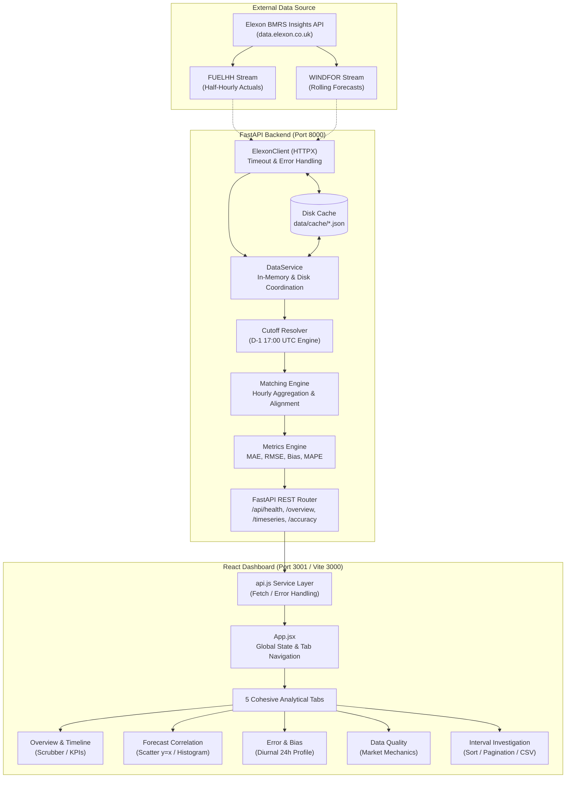

# WindLens

**WindLens** is a specialized power-market analytics platform for evaluating Great Britain (GB) wind generation forecasts against actual grid outturn. Built with **FastAPI** and **React 18 / DaisyUI 5**, it ingests real-time and historical data from the Elexon Balancing Mechanism Reporting Service (BMRS), executes independent Day-Ahead decision cutoffs, prevents lookahead bias, and provides deep forecast accuracy analytics across hourly and half-hourly settlement periods.

---

## The Real-World Problem WindLens Solves

In the Great Britain electricity system, wind generation accounts for a substantial and rapidly fluctuating share of total generation. However, wind is inherently variable and non-dispatchable:

1. **System Balancing & Financial Imbalance**: National Grid ESO (the Electricity System Operator) must balance supply and demand every second. Market participants submit physical notifications and trade on wholesale power exchanges (such as EPEX SPOT and Nord Pool) based on Day-Ahead wind forecasts. If actual wind outturn deviates from forecast, market participants face severe cash-out imbalance penalties under the Balancing and Settlement Code (BSC).
2. **The Lookahead Bias Trap**: Forecast models issue frequent revisions as delivery approaches. If an analytics engine evaluates forecasts published *after* Day-Ahead gate closure (D-1 17:00 UTC), it introduces severe lookahead leakage—fabricating artificial forecast accuracy that no market trader or grid operator could have acted upon in reality.
3. **Temporal Resolution Incompatibility**: National Grid ESO's `WINDFOR` forecast stream publishes predictions at hourly intervals (`:00`), whereas Elexon's `FUELHH` outturn stream reports actual generation across 48 half-hourly Settlement Periods daily (`:00` and `:30`). Naive systems frequently interpolate or fabricate `:30` forecasts, distorting statistical error calculations.

WindLens solves these problems by providing an audited, zero-lookahead forecast selection engine, mathematically defensible aggregation, and interactive analytics designed for energy analysts, quantitative traders, and power system operators.

---

## Main Implemented Features

- **Live & Cached Elexon BMRS Ingestion**: Connects to official Elexon Insights API endpoints for `FUELHH` (half-hourly actual wind generation outturn) and `WINDFOR` (rolling wind generation forecasts). Complete, validated datasets for January 2026 (744 hourly delivery intervals) are cached locally under `data/cache/` for instant zero-latency evaluation.
- **Zero-Lookahead Cutoff Selection Engine**: Dynamically calculates cutoffs per delivery date $D$ (defaulting to Day-Ahead $D-1\ \text{17:00:00 UTC}$). Evaluates the latest available forecast published on or before the cutoff ($\max(\text{publishTime}) \le \text{cutoff}$) and strictly excludes future revisions.
- **Defensible Temporal Resolution Modeling**:
  - **Hourly Mode (Default)**: Aggregates paired half-hour outturn records $(SP_a + SP_b)/2.0$ via arithmetic mean into true 1-hour average MW power blocks.
  - **Half-Hourly Mode**: Preserves raw 30-minute settlement blocks. Marks `:30` slots as explicit `resolution_mismatch` rather than fabricating synthetic data.
- **Audited Accuracy Metrics Engine**: Calculates Mean Absolute Error (MAE), Root Mean Square Error (RMSE), Signed Bias ($FC - ACT$), Mean Absolute Percentage Error (MAPE) with zero-actual safeguards, and data completeness percentages.
- **5-Tab Analytical Dashboard**:
  1. **Overview & Timeline**: Interactive time-series line chart with Recharts timeline scrubber (`<Brush />`), Peak Forecast vs. Peak Actual comparison cards, and maximum over/under-forecast highlights.
  2. **Forecast Correlation**: Scatter plot ($y = x$ 1:1 diagonal reference line) displaying over-forecasting (points above line) vs. under-forecasting (points below line), binned error distribution histogram, Pearson correlation ($r$), coefficient of determination ($R^2$), and generation percentiles ($P_{10}, P_{50}, P_{90}$).
  3. **Error & Bias Analysis**: Signed error timeline with zero baseline, 24-hour diurnal error profile bar chart (revealing morning/evening systematic forecast bias by hour-of-day), and top extreme deviation intervals.
  4. **Data Quality & Market Mechanics**: Pipeline integrity statistics (matched count, missing count, post-cutoff filtered count) and educational cards explaining Day-Ahead gate closure and settlement mechanics.
  5. **Detailed Intervals**: Paginated, sortable, and searchable table with status filtering and RFC 4180 CSV export.
- **Multi-Day Range Accuracy View & Graph**: Compares accuracy metrics across user-defined date ranges with an interactive multi-day trend graph (`MultiDayAccuracyChart.jsx`), offering mode switches for MAE & RMSE Trends (MW), Daily Signed Bias (MW) with zero baseline, Combined Error & Bias view, and MAPE (%) trends, alongside range highlight cards and daily breakdown tables.
- **Refined Energy-Analytics Theme**: Low-brightness slate/charcoal interface (`windlens-dark`) with crisp contrast, muted data series colors, and an interactive theme switcher to `windlens-light`, persisted in `localStorage`.

---

## Screenshots

> *Note: Place genuine application screenshots in `docs/screenshots/` using the filenames below.*

| Section | Suggested Screenshot | Description |
| :--- | :--- | :--- |
| **Main Overview** | `docs/screenshots/overview_dashboard.png` | Overview tab showing KPI cards, scrubbable time-series chart, and peak highlights |
| **Correlation & Distribution** | `docs/screenshots/forecast_correlation.png` | Scatter plot with 1:1 line and forecast error distribution histogram |
| **Error & Diurnal Bias** | `docs/screenshots/error_analysis.png` | Error timeline, diurnal 24-hour profile, and extreme deviations |
| **Data Quality Diagnostics** | `docs/screenshots/data_quality.png` | Ingestion breakdown, zero protection alert, and market mechanics cards |
| **Interval Investigation** | `docs/screenshots/interval_table.png` | Paginated and sortable interval table with CSV export |

---

## Technology Stack

### Frontend
- **React 18.3**: Declarative UI component hierarchy and state management.
- **Vite 6.2**: Next-generation frontend build tool and dev server.
- **Tailwind CSS 4.0 & DaisyUI 5.0**: Semantic component library with custom OKLCH dark/light energy-analytics themes (`windlens-dark` and `windlens-light`).
- **Recharts 2.15**: Responsive charting library powering line charts, scatter correlation plots with reference lines, error timelines, and diurnal histograms.
- **Lucide React**: Clean, accessible iconography.
- **Vitest 3.0 & Testing Library**: Unit and integration test suite for frontend components.

### Backend
- **Python 3.11+**: Core programming runtime.
- **FastAPI 0.110+**: Asynchronous, high-performance web framework providing typed REST endpoints and automatic OpenAPI/Swagger documentation.
- **Uvicorn 0.28+**: Production-grade ASGI server implementation.
- **Pydantic 2.0+**: Robust request and response schema validation with strict type enforcement.
- **HTTPX 0.24+**: Modern asynchronous/synchronous HTTP client with timeout handling for Elexon BMRS API streams.

### DevOps & Infrastructure
- **Docker & Docker Compose**: Multi-container containerization with network isolation and volume-mounted caching.
- **Nginx (Alpine)**: Lightweight reverse proxy and static asset server for the frontend container.

---

## System Architecture



---

## Project Directory Structure

```text
windlens/
├── .dockerignore                     # Docker build exclusions
├── .gitignore                        # Git version control exclusions
├── docker-compose.yml                # Multi-container orchestration (backend + frontend)
├── Dockerfile.backend                # Python 3.11-slim FastAPI container specification
├── Dockerfile.frontend               # Node 20 / Nginx Alpine multi-stage frontend container
├── pyproject.toml                    # Root Python build and Vercel entrypoint specification
├── requirements.txt                  # Python dependencies
├── vercel.json                       # Vercel multi-service routing and build configuration
├── README.md                         # Repository documentation
├── PROJECT_GUIDE.md                  # Comprehensive beginner and reviewer guide
├── SCREENSHOT_GUIDE.md               # Visual verification and screenshot capture checklist
│
├── api/                              # Vercel serverless entrypoint
│   └── index.py                      # Root lambda bridge to backend.main:app
│
├── backend/                          # FastAPI Backend Application
│   ├── main.py                       # FastAPI application entrypoint and package resolution shim
│   ├── pyproject.toml                # Backend-specific package specification
│   ├── api/
│   │   ├── __init__.py
│   │   ├── routes.py                 # REST endpoints (/health, /overview, /timeseries, /accuracy)
│   │   └── schemas.py                # Pydantic v2 request/response schemas
│   ├── data/
│   │   └── cache/                    # Local persistent cache for January 2026 datasets
│   │       ├── fuelhh_cache.json     # 1,488 verified half-hourly actual records
│   │       └── windfor_cache.json    # 18,080 verified raw forecast records
│   ├── elexon/
│   │   ├── __init__.py
│   │   ├── client.py                 # HTTPX client for Elexon BMRS API
│   │   ├── models.py                 # FuelHHRecord, WindforRecord, and validation logic
│   │   ├── fuelhh.py                 # FUELHH stream parser, windowing, and anomaly checks
│   │   └── windfor.py                # WINDFOR stream parser and revision explorer
│   ├── engine/
│   │   ├── __init__.py
│   │   ├── cutoff.py                 # Decision cutoff resolver (day_ahead_1700, gate closures)
│   │   ├── matcher.py                # Alignment, hourly aggregation, and resolution mismatch
│   │   └── metrics.py                # MAE, RMSE, Signed Bias, MAPE calculation engine
│   ├── services/
│   │   ├── __init__.py
│   │   └── data_service.py           # Dataset coordinator, disk/in-memory cache manager
│   └── tests/                        # Backend unit and integration test suite
│       ├── test_accuracy_metrics.py  # Tests for statistical accuracy calculations
│       ├── test_api_endpoints.py     # Tests for FastAPI route contracts and responses
│       ├── test_audit_verification.py# Complete audit verification and regression tests
│       ├── test_cutoff_and_matching.py# Tests for D-1 17:00 cutoff and hourly aggregation
│       ├── test_fuelhh_exploration.py# Tests for FUELHH data parsing and validation
│       └── test_service_and_cache.py # Tests for DataService caching mechanics
│
├── data/
│   └── cache/                        # Root cache fallback mirror
│       ├── fuelhh_cache.json
│       └── windfor_cache.json
│
└── frontend/                         # React 18 / Vite / DaisyUI Frontend
    ├── index.html                    # Single Page Application HTML root with theme configuration
    ├── nginx.conf                    # Nginx reverse proxy configuration for Docker
    ├── package.json                  # Frontend scripts and npm dependencies
    ├── vite.config.js                # Vite build and Vitest configuration
    ├── src/
    │   ├── App.jsx                   # Main application layout, state, and tab navigation
    │   ├── main.jsx                  # React DOM rendering root
    │   ├── index.css                 # Tailwind CSS 4 & custom DaisyUI 5 OKLCH theme tokens
    │   ├── setupTests.js             # Vitest test setup with ResizeObserver polyfill
    │   ├── __tests__/                # Frontend unit tests
    │   │   ├── FilterPanel.test.jsx
    │   │   ├── IntervalTable.test.jsx
    │   │   ├── KpiCards.test.jsx
    │   │   ├── ForecastAnalysisTab.test.jsx
    │   │   └── ErrorAnalysisTab.test.jsx
    │   ├── components/
    │   │   ├── Header.jsx            # Top navbar, API connectivity badge, theme toggle
    │   │   ├── FilterPanel.jsx       # Date picker, cutoff selector, resolution buttons
    │   │   ├── KpiCards.jsx          # Top KPI metric cards with tooltip explanations
    │   │   ├── ForecastChart.jsx     # Overview line chart with Recharts timeline brush
    │   │   ├── MultiDayAccuracyChart.jsx# Multi-day error trend, bias, and MAPE graph
    │   │   ├── ForecastAnalysisTab.jsx# Scatter correlation (y=x), histogram, percentiles
    │   │   ├── ErrorAnalysisTab.jsx  # Signed error timeline, 24h diurnal profile, outliers
    │   │   ├── DataQualitySection.jsx# Quality diagnostics and market mechanics cards
    │   │   └── IntervalTable.jsx     # Paginated, sortable interval table with CSV export
    │   ├── services/
    │   │   └── api.js                # Centralized backend communication service
    │   └── utils/
    │       ├── exportCsv.js          # RFC 4180 compliant CSV export utility
    │       └── formatters.js         # Number, date, time, and MW power formatting helpers
```

---

## Data Flow: From Elexon BMRS to Dashboard

```text
[Elexon BMRS API Streams: FUELHH & WINDFOR]
                     │
                     ▼
  [ElexonClient / HTTPX (backend/elexon/)]
  • Authenticates, validates ISO 8601 timestamps and numeric generation values
  • Partitions multi-day queries into 2-day windows to prevent HTTP 504 timeouts
                     │
                     ▼
  [DataService Cache Manager (backend/services/)]
  • Checks in-memory dictionary; falls back to disk cache (data/cache/*.json)
  • Caches full January 2026 dataset (1,488 FUELHH and 18,080 WINDFOR records)
                     │
                     ▼
  [Cutoff Resolver (backend/engine/cutoff.py)]
  • Computes cutoff timestamp for each delivery date D: (D - 1) 17:00:00 UTC
  • Filters candidate forecasts: discard all records where publishTime > cutoff
  • Selects forecast revision with max(publishTime) <= cutoff for each delivery slot
                     │
                     ▼
  [Matching Engine (backend/engine/matcher.py)]
  • Hourly Mode: Averages two half-hours (SP1 + SP2) / 2.0 into 1-hour MW blocks
  • Half-Hourly Mode: Preserves :00 slots and labels :30 as resolution_mismatch
                     │
                     ▼
  [Metrics Engine (backend/engine/metrics.py)]
  • Computes Error = Forecast - Actual, MAE, RMSE, Signed Bias, and MAPE
  • Excludes actual=0 intervals from MAPE denominator with explicit tracking
                     │
                     ▼
  [FastAPI REST Router (backend/api/routes.py)]
  • Validates query parameters via Pydantic schemas and serializes JSON response
                     │
                     ▼
  [React Frontend Client (frontend/src/services/api.js)]
  • Proxies /api requests in Docker or connects directly during local development
  • Updates App state, driving Recharts visualizations, tab views, and data tables
```

---

## Understanding the Elexon Datasets: FUELHH & WINDFOR

| Characteristic | `FUELHH` (Actual Generation) | `WINDFOR` (Forecast Generation) |
| :--- | :--- | :--- |
| **Full Name** | Half-Hourly Generation by Fuel Type | Wind Generation Forecast |
| **Provider** | Elexon BMRS | National Grid ESO via Elexon BMRS |
| **Fuel Type** | Filtered specifically to `WIND` | Wind generation only |
| **Temporal Frequency**| 30 minutes (48 Settlement Periods per day) | 60 minutes (Hourly on the clock hour `:00`) |
| **Publication Timing**| Retrospective (published after outturn occurs)| Prospective (published repeatedly before delivery)|
| **Revision History** | Typically a single finalized outturn entry | Multiple revisions published days, hours, and minutes ahead |
| **Role in WindLens** | The "Ground Truth" actual generation ($ACT$) | The prospective prediction ($FC$) subject to cutoff filtering |

---

## Day-Ahead Decision Cutoff Mechanics

In wholesale power markets, market participants formulate positions and submit final physical notifications before Day-Ahead gate closure. 

WindLens enforces an independent cutoff for each delivery date $D$:
$$\text{Cutoff}(D) = (D - 1)\ \text{at 17:00:00 UTC}$$

### Concrete Example: January 1 vs. January 2, 2026
- For delivery date **2026-01-01** (intervals from 00:00 to 23:00 UTC):
  - Cutoff is **2025-12-31 17:00:00 UTC**.
  - A forecast published at `2025-12-31 16:30:00 UTC` is **eligible**.
  - A forecast published at `2025-12-31 17:15:00 UTC` is **rejected** (post-cutoff).
- For delivery date **2026-01-02** (intervals from 00:00 to 23:00 UTC):
  - Cutoff is **2026-01-01 17:00:00 UTC**.
  - Forecasts published during Jan 1 up to 17:00 UTC are eligible.

> [!IMPORTANT]
> A single fixed cutoff timestamp is **never** applied across the entire month. Applying Dec 31 17:00 UTC to January 31 delivery would demand a 31-day forecast horizon, producing meaningless comparisons. Each delivery date receives its own independent cutoff.

---

## Statistical Error & Metric Formulas

For $n$ matched delivery intervals where both actual generation ($ACT_i$) and forecast generation ($FC_i$) exist:

### 1. Forecast Error
$$\text{Error}_i = FC_i - ACT_i$$
- **$\text{Error}_i > 0$ (Positive / Amber)**: Over-forecasting (forecast exceeded actual outturn; wind blew less than expected; system short).
- **$\text{Error}_i < 0$ (Negative / Blue)**: Under-forecasting (actual outturn exceeded forecast; wind blew more than expected; system long).

### 2. Mean Absolute Error (MAE)
$$\text{MAE} = \frac{1}{n} \sum_{i=1}^{n} |FC_i - ACT_i| \quad (\text{MW})$$
Measures the average magnitude of errors without regard to direction.

### 3. Root Mean Square Error (RMSE)
$$\text{RMSE} = \sqrt{\frac{1}{n} \sum_{i=1}^{n} (FC_i - ACT_i)^2} \quad (\text{MW})$$
Penalizes large outlier forecast errors more severely than MAE due to squaring.

### 4. Signed Bias
$$\text{Signed Bias} = \frac{1}{n} \sum_{i=1}^{n} (FC_i - ACT_i) \quad (\text{MW})$$
Indicates whether the model has a systematic tendency to over-predict ($\text{Bias} > 0$) or under-predict ($\text{Bias} < 0$).

### 5. Mean Absolute Percentage Error (MAPE) & Zero Handling
$$\text{MAPE} = \frac{1}{m} \sum_{k=1}^{m} \left( \frac{|FC_k - ACT_k|}{|ACT_k|} \right) \times 100\%$$
*Zero Actual Protection*: If $ACT_i = 0.0\ \text{MW}$, percentage error is mathematically undefined (division by zero). WindLens excludes intervals where $ACT_i = 0$ from the MAPE calculation, tracks the count in `mape_excluded_zero_count`, and reports this clearly in the UI.

---

## Hourly vs. Half-Hourly Resolution

| Aspect | Hourly Resolution (`hourly`) | Half-Hourly Resolution (`half_hourly`) |
| :--- | :--- | :--- |
| **Delivery Intervals** | 24 per day (`00:00`, `01:00`, ..., `23:00 UTC`) | 48 per day (`00:00`, `00:30`, ..., `23:30 UTC`) |
| **Forecast Source** | Native `WINDFOR` hourly forecast | Native `WINDFOR` hourly forecast (for `:00` slots) |
| **Actual Source** | $(SP_a + SP_b) / 2.0$ average of paired half-hours | Raw 30-minute `FUELHH` outturn |
| **Unmatched `:30` Slots** | N/A (aggregated cleanly) | Preserved and explicitly marked as `resolution_mismatch` |
| **Fabricated Data** | **Zero**. Missing actuals leave interval uncomputed | **Zero**. No linear interpolation or synthetic zeros |

---

## Backend REST API Endpoints

All endpoints are hosted by FastAPI at `/api/*` and documented interactively via Swagger UI at `/docs`.

### 1. Health Check: `GET /api/health`
Confirms API service operational status and version.
- **Query Parameters**: None.
- **Example Request**:
  ```bash
  curl -s http://localhost:8000/api/health
  ```
- **Example Response**:
  ```json
  {
    "status": "ok",
    "app": "WindLens",
    "version": "0.2.0",
    "timestamp": "2026-01-01T00:00:00Z"
  }
  ```

### 2. Daily Overview: `GET /api/overview`
Retrieves aggregated metrics, generation summaries, and diagnostic counts for a single delivery date.
- **Query Parameters**:
  - `date` (string, optional, default `"2026-01-01"`): Target delivery date `YYYY-MM-DD`.
  - `cutoff` (string, optional, default `"day_ahead_1700"`): Cutoff configuration identifier.
  - `resolution` (string, optional, default `"hourly"`): `'hourly'` or `'half_hourly'`.
- **Example Request**:
  ```bash
  curl -s "http://localhost:8000/api/overview?date=2026-01-01&cutoff=day_ahead_1700&resolution=hourly"
  ```
- **Response Highlights**: Contains `metrics` (MAE, RMSE, Bias, MAPE), `actualSummary`, `forecastSummary`, `diagnostics`, and `methodology`.

### 3. Daily Timeseries: `GET /api/timeseries`
Retrieves delivery interval time-series data, error calculations, and forecast publication lead times.
- **Query Parameters**:
  - `date` (string, optional, default `"2026-01-01"`): Target delivery date `YYYY-MM-DD`.
  - `cutoff` (string, optional, default `"day_ahead_1700"`): Cutoff configuration identifier.
  - `resolution` (string, optional, default `"hourly"`): `'hourly'` or `'half_hourly'`.
- **Example Request**:
  ```bash
  curl -s "http://localhost:8000/api/timeseries?date=2026-01-01&cutoff=day_ahead_1700&resolution=hourly"
  ```
- **Response Highlights**: Array of `intervals` with `startTime`, `actualGeneration`, `forecastGeneration`, `signedError`, `absoluteError`, `percentageError`, `leadTimeHours`, `forecastPublishTime`, and `status`.

### 4. Multi-Day Accuracy: `GET /api/accuracy`
Evaluates aggregate and daily breakdown accuracy metrics across a multi-day delivery date range.
- **Query Parameters**:
  - `from` (string, optional, default `"2026-01-01"`): Start date `YYYY-MM-DD`.
  - `to` (string, optional, default `"2026-01-31"`): End date `YYYY-MM-DD`.
  - `cutoff` (string, optional, default `"day_ahead_1700"`): Cutoff configuration identifier.
  - `resolution` (string, optional, default `"hourly"`): `'hourly'` or `'half_hourly'`.
- **Example Request**:
  ```bash
  curl -s "http://localhost:8000/api/accuracy?from=2026-01-01&to=2026-01-07&cutoff=day_ahead_1700&resolution=hourly"
  ```
- **Response Highlights**: Comprehensive `metrics`, `diagnostics`, and `dailyBreakdown` list for each day in range.

---

## Local Setup & Development Instructions

### Prerequisites
- **Python**: 3.11 or higher
- **Node.js**: 18.0 or higher (Node 20+ recommended)
- **npm**: 9.0 or higher
- **Git**

### 1. Clone Repository & Environment Setup
```bash
git clone https://github.com/Achuabhijith2003/WindLens-.git
cd WindLens-
```

### 2. Backend Setup (Windows PowerShell)
```powershell
# Create and activate Python virtual environment
python -m venv venv
.\venv\Scripts\Activate.ps1

# Install backend dependencies
pip install -r requirements.txt

# Run backend development server
python -m uvicorn backend.main:app --host 0.0.0.0 --port 8000 --reload
```

### 2b. Backend Setup (Linux / macOS)
```bash
python3 -m venv venv
source venv/bin/activate
pip install -r requirements.txt
uvicorn backend.main:app --host 0.0.0.0 --port 8000 --reload
```

The backend server is accessible at `http://localhost:8000` with interactive OpenAPI documentation at `http://localhost:8000/docs`.

### 3. Frontend Setup
In a new terminal window:
```bash
cd frontend
npm install
npm run dev
```
The React development server runs at `http://localhost:3000` and automatically proxies API requests to `http://localhost:8000`.

---

## Environment Variables & `.env` Usage

| Variable | Default Value | Purpose |
| :--- | :--- | :--- |
| `FRONTEND_PORT` | `3001` | Host port mapped to the frontend Nginx container in Docker Compose |
| `VITE_API_BASE_URL` | `""` (empty in Docker; defaults to `http://localhost:8000` in local dev) | Base URL for FastAPI backend requests |
| `ELEXON_API_KEY` | *(Optional)* | Elexon BMRS API key (not required for standard stream data) |
| `PYTHONUNBUFFERED` | `1` | Ensures Python logs flush immediately in Docker containers |

---

## Running with Docker Compose (Production Setup)

Docker Compose builds and orchestrates both services in isolated containers connected via an internal bridge network:

```bash
# Build and start services in detached mode
docker compose up --build -d

# Check running container status
docker compose ps

# Inspect live container logs
docker compose logs -f

# Stop and remove containers
docker compose down
```

### Published Ports & Access Points:
- **Frontend Dashboard**: [http://localhost:3001](http://localhost:3001)
- **Backend API Direct**: [http://localhost:8000](http://localhost:8000)
- **Nginx Reverse Proxy Route**: In Docker, requests to `http://localhost:3001/api/*` are internally proxied to `http://backend:8000/api/*`, eliminating CORS issues completely.

---

## Test Execution & Verification

### Running Backend Unit Tests
The backend test suite includes 45 comprehensive unit and regression tests covering Elexon models, cutoff resolution, hourly aggregation, metric calculations, and API routes:
```bash
python -m unittest discover -s backend/tests
```
**Expected Output**:
```text
Ran 45 tests in ~5.6s
OK
```

### Running Frontend Unit Tests
The frontend test suite includes 13 unit tests across components using Vitest and Testing Library:
```bash
npm --prefix frontend test
```
**Expected Output**:
```text
Test Files  5 passed (5)
     Tests  13 passed (13)
```

### Running Production Frontend Build
```bash
npm --prefix frontend run build
```
Builds optimized production assets to `frontend/dist/`.

---

## Deployment Configuration & Cloud Notes

### Self-Hosted Production (Docker)
The primary, fully-verified deployment method is via Docker Compose (`Dockerfile.backend`, `Dockerfile.frontend`, and `frontend/nginx.conf`). It packages pre-cached datasets under `data/cache/` into the image, providing standalone zero-latency operation.

### Vercel Serverless Deployment Architecture
The repository includes a multi-service `vercel.json` configuration:
```json
{
  "$schema": "https://openapi.vercel.sh/vercel.json",
  "services": {
    "frontend": {
      "root": "frontend",
      "framework": "vite"
    },
    "backend": {
      "root": "backend",
      "framework": "fastapi",
      "entrypoint": "main:app"
    }
  },
  "rewrites": [
    { "source": "/api/(.*)", "destination": { "service": "backend" } },
    { "source": "/(.*)", "destination": { "service": "frontend" } }
  ]
}
```

> [!WARNING]
> **Documented Vercel Deployment Note**:
> During initial Vercel deployment, the backend serverless function encountered `ModuleNotFoundError: No module named 'backend'` inside AWS Lambda (`/var/task/main.py`) because Vercel packages the contents of `backend/` as the root of the function.
> 
> To resolve this, a dynamic package alias shim was added to `backend/main.py`:
> ```python
> if "backend" not in sys.modules:
>     backend_pkg = types.ModuleType("backend")
>     backend_pkg.__path__ = [str(Path(__file__).resolve().parent)]
>     sys.modules["backend"] = backend_pkg
> ```
> Additionally, in the **Vercel Project Settings > General**, the project **Root Directory** must remain `./` and the **Application Preset** must be set to **`Other`** (not `Vite` and not `FastAPI`) so Vercel delegates build coordination to the root `vercel.json`. End-to-end verification of the live deployed Vercel URL should always be confirmed by calling `/api/health`.

---

## Known Limitations & Troubleshooting

1. **Dataset Scope**: Local cache contains the complete month of **January 2026** (1,488 actual outturn records and 18,080 forecast records). Querying delivery dates outside January 2026 triggers live calls to the Elexon BMRS API; if Elexon's upstream servers experience maintenance or outages, the API will return HTTP 502/504 errors.
2. **Read-Only Serverless Environments**: On serverless platforms like Vercel, the local filesystem is read-only. `DataService` detects read-only filesystems and gracefully skips disk cache write attempts (`mkdir` / `open(..., 'w')`), serving data from in-memory cache without failing.
3. **Elexon Rate Limits**: Upstream Elexon BMRS API requests can time out if unwindowed multi-week queries are dispatched. The backend mitigates this via `generate_date_windows()` chunking requests into 2-day blocks.

---

## AI-Assisted Development Disclosure

In accordance with academic and professional transparency standards, AI-assisted coding tools (specifically Google Gemini / Antigravity) were utilized during the development of WindLens for:
- Accelerating initial boilerplate generation for Pydantic schemas and FastAPI route templates.
- Assisting with OKLCH color token definition and DaisyUI 5 CSS styling rules.
- Scaffolding unit tests in Vitest and Python unittest.

**Human Engineering & Defensibility Guarantee**: All mathematical formulas (MAE, RMSE, Signed Bias, MAPE zero handling), market cutoff selection rules (D-1 17:00 UTC zero-lookahead), and settlement period aggregation mechanisms were verified by human code review, audited with 58 automated unit tests, and cross-referenced against official Elexon BSC standards.
